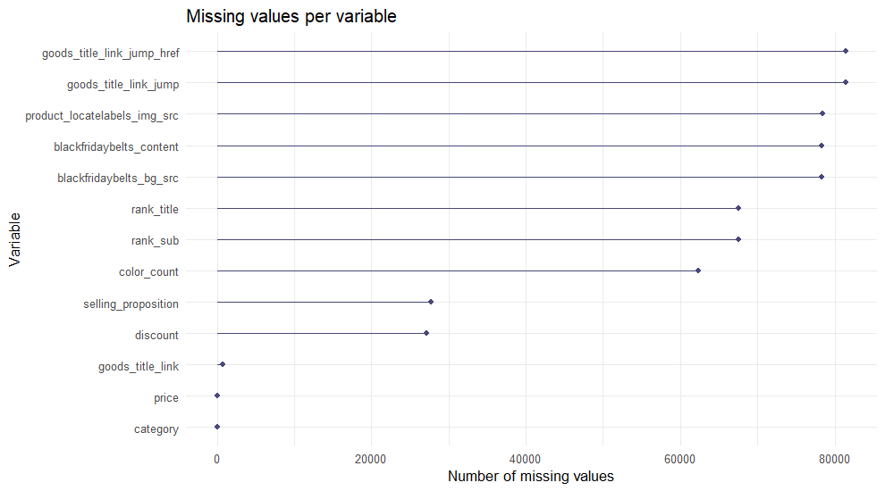

# Cleaning and transforming Shein product data with R

**Goal:** combine 21 raw category files of Shein products into **one consolidated,
trustworthy dataset**: consistent names and types, no meaningless columns, handled
missing values and no duplicated products.

**Source:** Kaggle, [Dirty E-Commerce Data (80,000+ products)](https://www.kaggle.com/datasets/oleksiimartusiuk/e-commerce-data-shein/data).
The 21 CSV files are in `original_databases/` (one per product category).

Required packages: `readr`, `dplyr`, `stringr`, `tidyr`, `naniar`, `ggplot2`, `writexl`.


``` r
library(readr)
library(dplyr)
library(stringr)
library(tidyr)
library(naniar)
library(ggplot2)
```

## 1. Load and combine the 21 files

Importing the files one by one is slow and repetitive, so every file is read in a
loop. The category is taken from the file name (`us-shein-<category>-<4 digits>.csv`)
and stored in a new column so products can still be told apart after combining.


``` r
files <- list.files("original_databases", pattern = "\\.csv$", full.names = TRUE)

raw_list <- lapply(files, function(f) {
  df <- read_csv(f, show_col_types = FALSE)
  df$category <- str_replace(tools::file_path_sans_ext(basename(f)), "^us-shein-(.*)-\\d{4}$", "\\1")
  df[] <- lapply(df, as.character)   # the files disagree on types; harmonise before binding
  df
})
raw <- bind_rows(raw_list)
n_raw <- nrow(raw)
```

The consolidated raw table has **82,105 rows** and
**13 columns** from **21 files**.

## 2. Standardise column names

Some names use hyphens, some underscores, and some contain spaces. They are
normalised to `snake_case`.


``` r
names(raw) <- names(raw) %>% str_replace_all("-", "_") %>% str_replace_all(" ", "_") %>% str_replace_all("_+", "_")
names(raw)
```

```
##  [1] "goods_title_link_jump"        "goods_title_link_jump_href"   "rank_title"                  
##  [4] "rank_sub"                     "price"                        "discount"                    
##  [7] "selling_proposition"          "goods_title_link"             "category"                    
## [10] "color_count"                  "blackfridaybelts_bg_src"      "blackfridaybelts_content"    
## [13] "product_locatelabels_img_src"
```

## 3. Fix variable types

Everything was read as text. `price` ("$12.99", sometimes "1,299.00") and
`discount` ("-25%") must become numeric; `color_count` becomes numeric too. A
direct conversion would silently create `NA`s, so the problematic text is removed
first (currency symbol, thousands separators and percent sign).


``` r
base <- raw %>%
  mutate(
    price       = as.numeric(str_replace_all(price, "[$,]", "")),
    discount    = as.numeric(str_replace_all(discount, "%", "")),
    color_count = as.numeric(color_count)
  )
```

Missing values after fixing the types:


``` r
miss_var_summary(base)
```

```
## # A tibble: 13 x 3
##    variable                     n_miss pct_miss
##    <chr>                         <int>    <num>
##  1 goods_title_link_jump         81441 99.2    
##  2 goods_title_link_jump_href    81441 99.2    
##  3 product_locatelabels_img_src  78483 95.6    
##  4 blackfridaybelts_bg_src       78314 95.4    
##  5 blackfridaybelts_content      78314 95.4    
##  6 rank_title                    67500 82.2    
##  7 rank_sub                      67500 82.2    
##  8 color_count                   62362 76.0    
##  9 selling_proposition           27741 33.8    
## 10 discount                      27128 33.0    
## 11 goods_title_link                678  0.826  
## 12 price                             2  0.00244
## 13 category                          0  0
```

``` r
gg_miss_var(base) +
  labs(title = "Missing values per variable", x = "Variable", y = "Number of missing values") +
  theme_minimal()
```



## 4. Decide what to do with missing values

Several variables are almost empty. With more than ~60-90% missing, a variable
usually carries too little information to be worth keeping. The decisions:

| Variable | Decision |
|---|---|
| `goods_title_link` (product name) | Fill gaps with `goods_title_link_jump` (an alternative field holding the same name) |
| `goods_title_link_jump`, `goods_title_link_jump_href`, `product_locatelabels_img_src`, `blackfridaybelts_bg_src`, `blackfridaybelts_content` | Drop (mostly empty or just URLs/images) |
| `rank_title` | Standardise ("#9 Best Seller" and "#9 Best Sellers" are the same) and label missing as `Unknown` |
| `rank_sub` | Drop (too many distinct values; `category` is cleaner) |
| `color_count` | Missing = 0 (assume no colour options listed) |
| `selling_proposition` | Missing = `No proposition` |
| `discount` | Missing = 0 (no discount) |


``` r
n_title_na_before <- sum(is.na(base$goods_title_link))

base <- base %>%
  mutate(goods_title_link = coalesce(goods_title_link, goods_title_link_jump)) %>%
  select(-goods_title_link_jump, -goods_title_link_jump_href, -product_locatelabels_img_src,
         -blackfridaybelts_bg_src, -blackfridaybelts_content, -rank_sub) %>%
  mutate(
    rank_title          = str_replace(rank_title, "Best Seller$", "Best Sellers"),
    rank_title          = replace_na(rank_title, "Unknown"),
    color_count         = replace_na(color_count, 0),
    selling_proposition = replace_na(selling_proposition, "No proposition"),
    discount            = replace_na(discount, 0)
  )
```

Missing product names went from **678** to
**14** after using the alternative field.


``` r
miss_var_summary(base) %>% filter(n_miss > 0)
```

```
## # A tibble: 2 x 3
##   variable         n_miss pct_miss
##   <chr>             <int>    <num>
## 1 goods_title_link     14  0.0171 
## 2 price                 2  0.00244
```

## 5. Remove duplicated products

The same product appears several times (the files overlap), and some appear with
**different prices**. The rule: keep **one row per product**; when prices differ,
keep the **highest price**.


``` r
dup_titles <- base %>% count(goods_title_link) %>% filter(n > 1, !is.na(goods_title_link))
price_conflicts <- base %>%
  filter(goods_title_link %in% dup_titles$goods_title_link) %>%
  group_by(goods_title_link) %>%
  summarise(n_prices = n_distinct(price), .groups = "drop") %>%
  filter(n_prices > 1)
```

* Products that appear more than once: **8,394**
* Of those, products with more than one price: **1,545**


``` r
clean <- base %>%
  filter(!is.na(goods_title_link)) %>%
  arrange(goods_title_link, desc(price)) %>%
  distinct(goods_title_link, .keep_all = TRUE)
```

After removing duplicates and the product with no name at all, the clean dataset has
**71,480 unique products** (from
82,105 raw rows).
## 6. Final names and order

Columns are renamed and reordered so the exported file is easy to read for other people.


``` r
clean <- clean %>%
  rename(product_name = goods_title_link, discount_pct = discount, rank = rank_title) %>%
  select(product_name, category, price, discount_pct, color_count, rank, selling_proposition)

glimpse(clean)
```

```
## Rows: 71,480
## Columns: 7
## $ product_name        <chr> "\" Bathroom Mat, Cute Anti-slip Ultra-fine Fiber Water Absorbent Bathroom Carpe~
## $ category            <chr> "home_textile", "tools_and_home_improvement", "kids", "beauty_and_health", "home~
## $ price               <dbl> 11.60, 15.65, 0.77, 3.20, 4.30, 1.70, 60.00, 60.00, 1.20, 1.96, 12.20, 6.83, 0.8~
## $ discount_pct        <dbl> 0, -50, -52, -9, 0, 0, -8, -8, 0, -51, 0, -25, -38, -5, -2, 0, 0, -29, -50, -10,~
## $ color_count         <dbl> 0, 0, 0, 27, 0, 0, 0, 0, 0, 0, 0, 0, 0, 0, 0, 0, 4, 0, 0, 0, 0, 0, 0, 0, 0, 4, 0~
## $ rank                <chr> "Unknown", "Unknown", "Unknown", "Unknown", "Unknown", "Unknown", "Unknown", "Un~
## $ selling_proposition <chr> "500+ sold recently", "No proposition", "100+ sold recently", "400+ sold recentl~
```

``` r
miss_var_summary(clean)
```

```
## # A tibble: 7 x 3
##   variable            n_miss pct_miss
##   <chr>                <int>    <num>
## 1 product_name             0        0
## 2 category                 0        0
## 3 price                    0        0
## 4 discount_pct             0        0
## 5 color_count              0        0
## 6 rank                     0        0
## 7 selling_proposition      0        0
```

## 7. Export

The clean dataset is saved to `final_database/shein_products_clean.xlsx`.


``` r
dir.create("final_database", showWarnings = FALSE)
writexl::write_xlsx(clean, "final_database/shein_products_clean.xlsx")
```

